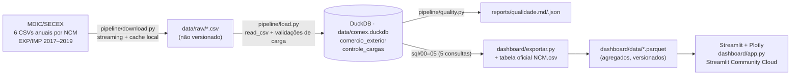

# Arquitetura

## Fluxo de dados

| Etapa | Comando | Entrada → saída |
|---|---|---|
| Carga | `python -m pipeline.run` | 6 CSVs do MDIC → `data/comex.duckdb` + relatório de qualidade |
| Revalidação | `python -m pipeline.validar` | banco existente → relatório de qualidade (sem download) |
| Análises | `python -m pipeline.analises` | banco → 5 CSVs em `reports/analises/` (opcional) |
| Publicação | `python -m dashboard.exportar` | banco + `NCM.csv` → `dashboard/data/*.parquet` |
| Dashboard | `streamlit run dashboard/app.py` | Parquets → interface web |

## Fontes
- Arquivos anuais `EXP_<ano>.csv` e `IMP_<ano>.csv` (2017, 2018, 2019) em
  `https://balanca.mdic.gov.br/balanca/bd/comexstat-bd/ncm/` (`pipeline/sources.py`). A base histórica
  `*_COMPLETA` é recusada no código.
- Tabela de produtos `https://balanca.mdic.gov.br/balanca/bd/tabelas/NCM.csv`, usada apenas para a
  descrição oficial (`NO_NCM_POR`).

## Granularidade
- **`comercio_exterior`:** uma linha por `(ano, mes, uf, ncm, tipo_operacao)`, que também é a chave
  primária, com `valor_fob_usd` somado. Dimensões da origem fora do escopo (país, via, URF, unidade,
  quantidade, peso) são descartadas na carga.
- **`controle_cargas`:** uma linha por arquivo de origem: nome, ano, operação, SHA-256, número de linhas
  e total FOB lido do CSV.
- **Parquets publicados:** resultado das 5 consultas, ou seja, o top 3 por UF/ano, o top 3 por UF/mês
  e as participações por UF, mais a descrição NCM.

## Tecnologias e armazenamento
| Camada | Tecnologia | Onde fica |
|---|---|---|
| Ingestão e carga | Python 3, `requests`, DuckDB `read_csv` | `data/raw/` e `data/comex.duckdb` (ignorados pelo git) |
| Análises | SQL do DuckDB (CTEs e `row_number()`) | `sql/` |
| Publicação | DuckDB `COPY ... (FORMAT parquet)` | `dashboard/data/` (versionado, alguns KB) |
| Visualização | Streamlit + Plotly | Streamlit Community Cloud |
| Qualidade | `pipeline/quality.py`, pytest, GitHub Actions | `reports/`, `tests/`, `.github/workflows/` |

## Idempotência
1. **Download:** um arquivo que já existe em `data/raw/` é reaproveitado (`--forcar-download` baixa de novo).
2. **Carga:** se o SHA-256 do arquivo for igual ao registrado em `controle_cargas`, a carga é ignorada.
   Se o arquivo mudou, os dados de `(ano, tipo_operacao)` são substituídos com `DELETE` + `INSERT` dentro
   de uma transação. Qualquer falha de validação gera `ROLLBACK` e o banco fica como estava.
3. **Chave primária:** a PK de `comercio_exterior` impede duplicidade mesmo que alguém insira dados manualmente.
4. **Publicação:** `dashboard/exportar.py` sobrescreve os Parquets a partir do banco, de forma
   determinística (desempate dos rankings pelo menor NCM).

## Principais decisões
- **DuckDB embarcado:** lê CSV grande direto, sem servidor e sem carregar tudo em pandas. Atende bem ao
  volume de três anos.
- **Agregação na carga:** reduz o volume e já entrega a granularidade usada pelas análises.
- **SQL em arquivos `.sql`:** as consultas ficam legíveis e revisáveis e são executadas tal como estão
  pelo runner e pelo exportador.
- **Publicar só agregados:** o banco e os CSVs (centenas de MB) não vão para o GitHub. O dashboard lê
  apenas os 5 Parquets, e por isso funciona no Streamlit Cloud sem baixar dados do MDIC.
- **UFs especiais:** são mantidas no banco e tratadas nas consultas: ficam fora dos rankings e entram no
  total das participações (detalhes em [VALIDACAO.md](VALIDACAO.md)).
- **Sem camadas artificiais:** o fluxo é linear (CSV → DuckDB → SQL → Parquet). Não foi criada uma
  arquitetura medalhão (bronze/prata/ouro) porque o escopo não pede.
